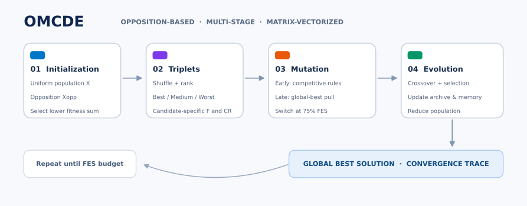
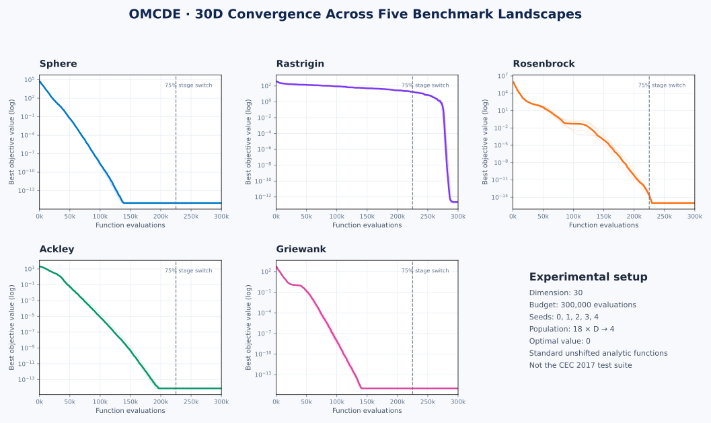

<div align="center">

# OMCDE
### Opposition-based Multi-Stage Matrix-Based Competitive Differential Evolution

**Matrix-vectorized global optimization · adaptive triplet competition · NumPy implementation**

[](https://www.python.org/)
[](https://numpy.org/)
[](OMCDE.ipynb)

</div>



## Overview

**OMCDE** is a population-based optimizer for bounded continuous minimization. It combines **population-level opposition initialization**, **fitness-ranked triplet competition**, **history-adaptive mutation parameters**, **a stage-dependent change from exploration to greedy exploitation**, and **linear population reduction**. All candidate-wise mutation, crossover, evaluation, and selection operations are vectorized in NumPy.

Based on *OMCDE: Opposition-based Multi-Stage Matrix-Based Competitive Differential Evolution*, by **Mohammad Sarhangzadeh, Shahryar Rahnamayan, and Doruk Oner**. This repository is an accessible implementation of the published algorithm description with implementation choices documented below, **not a claim of exact numerical reproduction of the paper's CEC 2017 table**.

## Algorithm

1. **Initialize:** uniformly sample `X`, construct `X_opp = L + U - X`, and choose the *whole population* with the lower sum of fitness values.
2. **Compete:** shuffle individuals into random triplets; label their fitness ranks *best*, *medium*, and *worst*.
3. **Mutate:** the three ranks receive distinct mutation equations. For `FES ≤ 0.75 × FES_max`, use competitive TCDE-style mutation; afterward, add an attraction toward the global best.
4. **Recombine and select:** binomial crossover with at least one forced mutant dimension, then retain improved offspring.
5. **Adapt:** update the external archive, success-history memories for `F` and `CR`, and the population size as evaluations are consumed.

The full mathematical walkthrough is in [**OMCDE.ipynb**](OMCDE.ipynb); the reusable implementation is in [`omcde.py`](omcde.py).

## Five benchmark results — 30 dimensions

**Actual executions of this repository's implementation** on five *standard unshifted/unrotated analytic functions* (these are **not CEC 2017** test functions). Every function was minimized with five independent seeds (`0–4`), **300,000 function evaluations per run**, `N_init=540`, `N_min=4`, archive capacity `1.4N`, `H=6`, and a stage switch at 75% of evaluations.

| Function | Bounds (each coordinate) | Best fitness | Mean fitness ± sample SD |
|:--|--:|--:|--:|
| Sphere | [-100, 100] | 5.90e-91 | 3.23e-88 ± 5.08e-88 |
| Rastrigin | [-5.12, 5.12] | 1.71e-13 | 3.87e-13 ± 4.20e-13 |
| Rosenbrock | [-5, 10] | 0.00 | 0.00 ± 0.00 |
| Ackley | [-32.768, 32.768] | 7.55e-15 | 7.55e-15 ± 0.00 |
| Griewank | [-600, 600] | 0.00 | 0.00 ± 0.00 |

All objective functions have known minimum value `0`. Exact zero printed by a floating-point objective does **not** guarantee an exact mathematical optimum. Single-machine runtime observations are implementation- and hardware-dependent. Five seeds are demonstrations, **not** significance tests or comparisons to other solvers.



The vertical dashed line indicates the 75% stage switch. The solid lines are **median best-so-far fitness** across five independent runs; transparent lines show individual runs. Values are floored at 1e-15 for readability on the log axis. Full results, timing, and convergence samples are saved in [`results/`](results/).

## Install and run

```bash
python -m pip install -r requirements.txt
jupyter notebook OMCDE.ipynb
```

**Use the reusable optimizer:**

```python
import numpy as np
from omcde import omcde

def sphere(X):
    return np.sum(X ** 2, axis=1)

result = omcde(sphere, dim=30, bounds=(-100, 100), max_evals=300_000, seed=0)
print('Best fitness:', result.fun)
print('Best solution:', result.x)
```

The objective receives a matrix `(N, D)` and must return one minimization fitness value per row, shape `(N,)`. Run all 25 D=30 benchmark experiments again with:

```bash
python run_benchmarks.py
```

```bash
python -m unittest discover -s tests -v
```

## Paper settings and implementation choices

| Setting | Value |
|:--|--:|
| `N_init` | 18 × D |
| `N_min` | 4 |
| Evaluation budget | 10,000 × D |
| Memory length `H` | 6 |
| Archive capacity | floor(1.4 × current N) |
| Stage threshold | 0.75 |
| Initial memory F, CR | 0.5 |

The manuscript leaves a few implementation details open. This implementation (1) **counts both original and opposite population evaluations** toward the fitness budget, although Algorithm 1 initializes `FES=N_init`; (2) pads non-multiple-of-3 triplets with *temporary companion indices*, because the reported minimum N=4 cannot be reshaped into triplets; (3) uses feasible-parent midpoint bound repair (optional clipping); (4) archives replaced parents, with uniform archive downsampling; (5) applies success-weighted Lehmer updates to both F and CR; and (6) evaluates a partial last generation so the budget is never exceeded. These choices may affect reproduction of the exact CEC results.

## Files

```text
OMCDE.ipynb                    Illustrated, self-contained tutorial notebook
omcde.py                      Importable vectorized OMCDE optimizer
run_benchmarks.py             Reproducible 30D × 5-functions × 5-seeds driver
results/benchmark_d30_runs.csv       25 individual runs
results/benchmark_d30_summary.csv    Means, SDs, and extrema
results/benchmark_d30_curves.json    Sampled convergence curves
results/convergence_d30.svg          Five-panel benchmark visualization
results/omcde_workflow.svg           Method diagram
tests/test_omcde.py           Equation and behavior tests
```

## Citation

If this repository is useful, cite the **OMCDE paper** by Mohammad Sarhangzadeh, Shahryar Rahnamayan, and Doruk Oner. Add the full publication bibliographic entry here once its final venue/DOI information is available.

**License:** No license is included; please choose one before explicitly granting reuse rights.