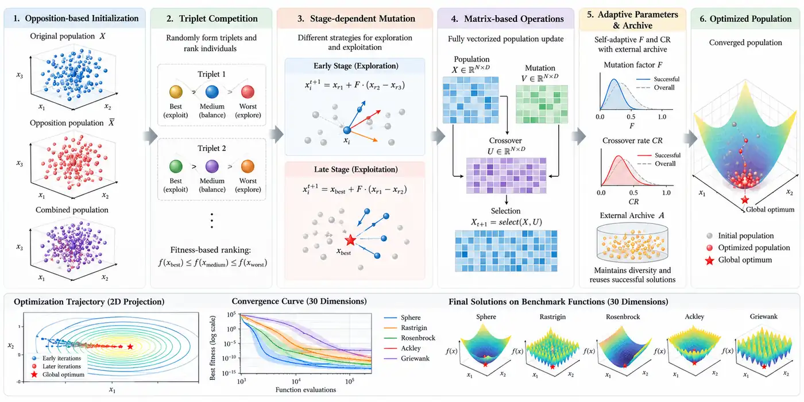

<div align="center">

# OMCDE
### Opposition-based Multi-Stage Matrix-Based Competitive Differential Evolution

**Matrix-vectorized global optimization · adaptive triplet competition · NumPy implementation**

[](https://www.python.org/)
[](https://numpy.org/)
[](OMCDE.ipynb)

</div>



*Scientific overview of opposition initialization, triplet competition, stage-dependent mutation, vectorized operations, parameter adaptation, and convergence. Conceptual illustration; consult equations below for the precise mathematical method.*

## Overview

**OMCDE** is a population-based optimizer for bounded continuous minimization. It combines **population-level opposition initialization**, **fitness-ranked triplet competition**, **history-adaptive mutation parameters**, **a stage-dependent change from exploration to greedy exploitation**, and **linear population reduction**. All candidate-wise mutation, crossover, evaluation, and selection operations are vectorized in NumPy.

Based on *OMCDE: Opposition-based Multi-Stage Matrix-Based Competitive Differential Evolution*, by **Mohammad Sarhangzadeh, Shahryar Rahnamayan, and Doruk Oner**. This repository is an accessible implementation of the published algorithm description with implementation choices documented below, **not a claim of exact numerical reproduction of the paper's CEC 2017 table**.

## Algorithm 1 — OMCDE from the paper

The following pseudocode follows **Algorithm 1** (Section IV) of the manuscript. In every generation, the population is handled as matrices, and competition determines each candidate's mutation role. The paper calls the procedure *Opposition-Controlled Matrix-Based Competitive Differential Evolution* in the algorithm caption.

```text
Input:  N_init, D, FES_max, lower and upper bounds [L, U]
Output: global best solution x_gbest

1. Initialization
   X ← uniform random population in [L, U]
   X_opp ← (L + U) − X
   X ← X_opp if sum(f(X_opp)) < sum(f(X)); otherwise retain X
   Initialize M_F and M_CR with 0.5; set FES = N_init

while FES < FES_max:
    2. Linear population reduction and parameter generation
       Compute N_next by Eq. (18); if smaller, remove worst individuals
       Sample F and CR vectors from history using Eq. (15)

    3. Triplet competition
       Randomly form triplets, rank their members by fitness
       Extract X_best, X_med, X_worst

    4. Stage-dependent mutation
       if FES ≤ λ · FES_max:
           Apply competitive mutations (Eqs. 2–4)
       else:
           Broadcast x_gbest to the triplet groups
           Apply greedy mutations (Eqs. 12–14)

    5. Vectorized crossover and selection
       Assemble mutant population V
       Construct trial population T by binomial crossover (Eq. 8)
       Evaluate f(T), build improvement mask S
       Keep better candidates using vectorized selection (Eq. 9)

    6. Adaptation
       Store replaced parent solutions in archive A
       Update M_F and M_CR via the weighted Lehmer mean (Eq. 16)
       FES ← FES + N

return x_gbest
```

### Rank-conditioned, two-stage mutation

For each triplet, let **b**, **m**, and **w** denote the best, medium, and worst solutions (in increasing fitness order). The scaling factor `F` is sampled for each individual. Here `r1` and `r2` are random difference-vector sources from the population/archive, as described in the paper.

**Stage I: competitive exploration**, `FES ≤ λ·FES_max` (Eqs. 2–4):

$$
\begin{aligned}
v_b &= b + F_b(r_1-r_2), \\
v_m &= m + F_m(b-m) + F_m(r_1-r_2), \\
v_w &= w + F_w(b-w) + F_w(m-w).
\end{aligned}
$$

**Stage II: greedy exploitation**, `FES > λ·FES_max` (Eqs. 12–14), with global best **g**:

$$
\begin{aligned}
v_b &= b + F_b(g-b) + F_b(r_1-r_2), \\
v_m &= m + F_m(g-m) + F_m(b-m) + F_m(r_1-r_2), \\
v_w &= w + F_w(g-w) + F_w(b-w) + F_w(m-w).
\end{aligned}
$$

History-adapted control parameters are drawn from `Cauchy(M_F[r], 0.1)` and `Normal(M_CR[r], 0.1)`. Successful parameter values are aggregated through a fitness-improvement-weighted Lehmer mean, blended 50/50 with their old memory entry (Eqs. 15–17). Linear population reduction follows Eq. (18):

$$
N_{g+1}=\operatorname{round}\!\left(N_{\mathrm{init}} + \frac{N_{\min}-N_{\mathrm{init}}}{FES_{\max}}\,FES\right).
$$

> **Implementation note:** The paper's `FES = N_init` initialization and triplet reshaping are reproduced above as written. The notebook/code document pragmatic adjustments for counting *both* opposition evaluations and handling `N_min = 4` (not divisible by three).

## CEC 2017 — results reported in the paper

**Table I from the supplied OMCDE manuscript**, not newly generated by this repository. The paper evaluates **29 CEC 2017 functions (F1 and F3–F30; F2 excluded)** at **D = 30**, using **31 independent runs** and **300,000 function evaluations per run**. Values are **mean ± standard deviation of optimization error**, `f(x_best) − f(x*)` (smaller is better).

The `(+), (=), (−)` tags on competitor means are the paper's **Wilcoxon rank-sum comparisons at α = 0.05**, interpreted from OMCDE's perspective: **+** OMCDE significantly better, **=** statistically similar, **−** OMCDE significantly worse.

| Function | **OMCDE** | TCDE | LSHADE-RSP | iLSHADE-RSP | L-SHADE | JADE |
|:--|--:|--:|--:|--:|--:|--:|
| **Unimodal functions** | | | | | | |
| F1 | **0.00E+00 ± 0.00E+00** | 0.00E+00 ± 0.00E+00 (=) | 0.00E+00 ± 0.00E+00 (=) | 0.00E+00 ± 0.00E+00 (=) | 0.00E+00 ± 0.00E+00 (=) | 0.00E+00 ± 0.00E+00 (=) |
| F3 | **0.00E+00 ± 0.00E+00** | 0.00E+00 ± 0.00E+00 (=) | 0.00E+00 ± 0.00E+00 (=) | 0.00E+00 ± 0.00E+00 (=) | 0.00E+00 ± 0.00E+00 (=) | 9.43E+03 ± 1.54E+04 (+) |
| **Multimodal functions** | | | | | | |
| F4 | **5.86E+01 ± 0.00E+00** | 5.86E+01 ± 0.00E+00 (=) | 5.86E+01 ± 0.00E+00 (=) | 2.27E+01 ± 7.02E-01 (−) | 5.87E+01 ± 7.70E-01 (=) | 4.88E+01 ± 2.39E+01 (−) |
| F5 | **3.52E+00 ± 1.62E+00** | 4.83E+00 ± 1.31E+00 (+) | 7.11E+00 ± 2.09E+00 (+) | 7.89E+00 ± 2.38E+00 (+) | 6.77E+00 ± 1.60E+00 (+) | 2.63E+01 ± 4.00E+00 (+) |
| F6 | **0.00E+00 ± 2.53E-08** | 8.54E-06 ± 5.44E-06 (+) | 0.00E+00 ± 2.71E-08 (=) | 5.77E-08 ± 1.34E-07 (+) | 0.00E+00 ± 1.92E-08 (=) | 0.00E+00 ± 0.00E+00 (=) |
| F7 | **3.60E+01 ± 1.11E+00** | 3.64E+01 ± 9.10E-01 (+) | 3.95E+01 ± 2.50E+00 (+) | 4.08E+01 ± 3.42E+00 (+) | 3.77E+01 ± 1.42E+00 (+) | 5.46E+01 ± 4.02E+00 (+) |
| F8 | **5.26E+00 ± 1.48E+00** | 6.92E+00 ± 1.84E+00 (+) | 7.38E+00 ± 2.28E+00 (+) | 7.93E+00 ± 2.39E+00 (+) | 7.24E+00 ± 1.59E+00 (+) | 2.64E+01 ± 3.83E+00 (+) |
| F9 | **0.00E+00 ± 0.00E+00** | 0.00E+00 ± 0.00E+00 (=) | 0.00E+00 ± 0.00E+00 (=) | 0.00E+00 ± 0.00E+00 (=) | 0.00E+00 ± 0.00E+00 (=) | 3.51E-03 ± 1.75E-02 (=) |
| F10 | **1.46E+03 ± 3.06E+02** | 1.98E+03 ± 1.88E+02 (+) | 1.92E+03 ± 3.31E+02 (+) | 1.90E+03 ± 3.46E+02 (+) | 1.49E+03 ± 1.51E+02 (=) | 1.92E+03 ± 2.15E+02 (+) |
| **Hybrid functions** | | | | | | |
| F11 | **1.91E+01 ± 2.42E+01** | 2.01E+01 ± 2.57E+01 (=) | 2.62E+00 ± 2.23E+00 (−) | 3.41E+00 ± 5.57E+00 (−) | 28.8E+01 ± 2.81E+01 (+) | 3.68E+01 ± 2.65E+01 (+) |
| F12 | **1.84E+02 ± 1.29E+02** | 2.27E+02 ± 2.36E+02 (=) | 9.51E+01 ± 7.16E+01 (−) | 1.20E+02 ± 7.85E+01 (=) | 1.06E+09 ± 3.76E+02 (+) | 1.15E+03 ± 3.87E+02 (+) |
| F13 | **1.09E+01 ± 9.66E+00** | 1.58E+01 ± 9.64E+00 (+) | 1.73E+01 ± 5.41E+00 (+) | 1.80E+01 ± 4.92E+00 (+) | 1.72E+01 ± 4.75E+00 (+) | 4.79E+01 ± 5.92E+01 (+) |
| F14 | **2.10E+01 ± 4.13E+00** | 2.21E+01 ± 1.27E+00 (+) | 2.15E+01 ± 1.23E+00 (=) | 2.17E+01 ± 1.06E+00 (+) | 2.16E+01 ± 1.24E+00 (+) | 7.30E+03 ± 2.70E+04 (=) |
| F15 | **1.11E+00 ± 1.85E-01** | 1.73E+00 ± 5.86E-01 (+) | 1.34E+00 ± 7.73E-01 (=) | 1.18E+00 ± 7.50E-01 (=) | 3.10E+00 ± 1.46E+00 (+) | 7.71E+02 ± 1.82E+03 (+) |
| F16 | **2.53E+01 ± 1.06E+01** | 3.69E+01 ± 4.12E+01 (=) | 2.87E+01 ± 4.35E+01 (=) | 1.86E+01 ± 6.87E+00 (−) | 6.25E+01 ± 7.43E+01 (+) | 3.83E+02 ± 1.45E+02 (+) |
| F17 | **4.02E+01 ± 9.45E+00** | 4.48E+01 ± 1.15E+01 (+) | 3.78E+01 ± 7.04E+00 (=) | 3.89E+01 ± 7.18E+00 (=) | 3.31E+01 ± 6.94E+00 (−) | 7.70E+01 ± 3.12E+01 (+) |
| F18 | **2.10E+01 ± 3.42E-01** | 2.14E+01 ± 5.04E-01 (+) | 2.08E+01 ± 2.89E-01 (−) | 2.08E+01 ± 2.88E-01 (−) | 2.19E+01 ± 1.07E+00 (+) | 1.58E+04 ± 4.77E+04 (=) |
| F19 | **3.46E+00 ± 1.34E+00** | 4.18E+00 ± 1.78E+00 (+) | 3.49E+00 ± 1.08E+00 (=) | 3.49E+00 ± 6.06E-01 (=) | 5.38E+00 ± 1.40E+00 (+) | 1.27E+03 ± 3.62E+03 (=) |
| F20 | **3.21E+01 ± 1.00E+01** | 3.86E+01 ± 9.20E+00 (+) | 3.38E+01 ± 9.50E+00 (=) | 3.24E+01 ± 7.02E+00 (=) | 4.10E+01 ± 8.81E+00 (+) | 1.21E+02 ± 6.10E+01 (+) |
| **Composition functions** | | | | | | |
| F21 | **2.04E+02 ± 1.02E+00** | 2.22E+02 ± 1.87E+00 (+) | 2.07E+02 ± 2.19E+00 (+) | 2.08E+02 ± 2.36E+00 (+) | 2.07E+02 ± 1.49E+00 (+) | 2.27E+02 ± 5.36E+00 (+) |
| F22 | **1.00E+02 ± 0.00E+00** | 1.10E+02 ± 0.00E+00 (+) | 1.00E+02 ± 0.00E+00 (=) | 1.00E+02 ± 0.00E+00 (=) | 1.00E+02 ± 0.00E+00 (=) | 1.45E+02 ± 3.18E+02 (=) |
| F23 | **3.52E+02 ± 2.86E+00** | 3.52E+02 ± 3.07E+00 (=) | 3.51E+02 ± 3.47E+00 (=) | 3.50E+02 ± 3.29E+00 (−) | 3.49E+02 ± 2.70E+00 (−) | 3.74E+02 ± 6.00E+00 (+) |
| F24 | **4.20E+02 ± 1.75E+00** | 4.32E+02 ± 2.18E+00 (+) | 4.27E+02 ± 2.10E+00 (+) | 4.26E+02 ± 2.45E+00 (+) | 4.26E+02 ± 1.67E+00 (+) | 4.40E+02 ± 4.50E+00 (+) |
| F25 | **3.87E+02 ± 1.73E-02** | 3.87E+02 ± 1.54E-02 (=) | 3.87E+02 ± 0.00E+00 (=) | 3.79E+02 ± 0.00E+00 (−) | 3.87E+02 ± 0.00E+00 (=) | 3.87E+02 ± 0.00E+00 (=) |
| F26 | **1.01E+03 ± 4.84E+01** | 1.03E+03 ± 5.60E+01 (+) | 9.38E+02 ± 3.77E+01 (−) | 9.33E+02 ± 3.92E+01 (−) | 9.28E+02 ± 3.64E+01 (−) | 1.18E+03 ± 1.43E+02 (+) |
| F27 | **4.90E+02 ± 3.86E+00** | 5.01E+02 ± 4.57E+00 (+) | 4.98E+02 ± 7.29E+00 (+) | 4.79E+02 ± 6.51E+00 (−) | 5.04E+02 ± 5.50E+00 (+) | 5.03E+02 ± 7.56E+00 (+) |
| F28 | **3.13E+02 ± 3.46E+01** | 3.28E+02 ± 4.57E+01 (=) | 3.04E+02 ± 2.21E+01 (=) | 3.02E+02 ± 1.60E+01 (=) | 3.30E+02 ± 4.86E+01 (+) | 3.42E+02 ± 5.91E+01 (+) |
| F29 | **4.31E+02 ± 2.93E+01** | 4.42E+02 ± 3.14E+01 (=) | 4.46E+02 ± 1.39E+01 (+) | 4.14E+02 ± 2.72E+01 (−) | 4.34E+02 ± 6.46E+00 (+) | 4.82E+02 ± 3.84E+01 (+) |
| F30 | **2.02E+03 ± 1.46E+01** | 2.02E+03 ± 1.14E+01 (=) | 1.97E+03 ± 1.10E+02 (−) | 1.04E+03 ± 3.21E+02 (−) | 1.98E+03 ± 4.71E+01 (−) | 2.35E+03 ± 1.36E+03 (=) |

**Paper-level statistical summary:**

| Statistic | OMCDE | TCDE | LSHADE-RSP | iLSHADE-RSP | L-SHADE | JADE |
|:--|--:|--:|--:|--:|--:|--:|
| OMCDE wins/ties/losses | — | 17/12/0 | 9/15/5 | 9/10/10 | 17/8/4 | 19/9/1 |
| Friedman mean rank (lower is better) | **2.36** | 4.02 | 2.98 | 2.64 | 3.53 | 5.47 |

Values above have been transcribed from the paper's table **as printed**, including its unusual scientific-notation entries in some rows. The machine-readable transcription is in [`results/paper_cec2017_table1.csv`](results/paper_cec2017_table1.csv).

---

## Five benchmark results — 30 dimensions

**Actual executions of this repository's implementation** on five *standard unshifted/unrotated analytic functions* (these are **not CEC 2017** test functions). Every function was minimized with five independent seeds (`0–4`), **300,000 function evaluations per run**, `N_init=540`, `N_min=4`, archive capacity `1.4N`, `H=6`, and a stage switch at 75% of evaluations.

| Function | Bounds (each coordinate) | Best fitness | Mean fitness ± sample SD |
|:--|--:|--:|--:|
| Sphere | [-100, 100] | 5.90e-91 | 3.23e-88 ± 5.08e-88 |
| Rastrigin | [-5.12, 5.12] | 1.71e-13 | 3.87e-13 ± 4.20e-13 |
| Rosenbrock | [-5, 10] | 0.00 | 0.00 ± 0.00 |
| Ackley | [-32.768, 32.768] | 7.55e-15 | 7.55e-15 ± 0.00 |
| Griewank | [-600, 600] | 0.00 | 0.00 ± 0.00 |

All objective functions have known minimum value `0`. Exact zero printed by a floating-point objective does **not** guarantee an exact mathematical optimum. Single-machine runtime observations are implementation- and hardware-dependent. Five seeds are demonstrations, **not** significance tests or comparisons to other solvers.


The vertical dashed line indicates the 75% stage switch. The solid lines are **median best-so-far fitness** across five independent runs; transparent lines show individual runs. Values are floored at 1e-15 for readability on the log axis. Full results, timing, and convergence samples are saved in [`results/`](results/).

## Install and run

```bash
python -m pip install -r requirements.txt
jupyter notebook OMCDE.ipynb
```

**Use the reusable optimizer:**

```python
import numpy as np
from omcde import omcde

def sphere(X):
    return np.sum(X ** 2, axis=1)

result = omcde(sphere, dim=30, bounds=(-100, 100), max_evals=300_000, seed=0)
print('Best fitness:', result.fun)
print('Best solution:', result.x)
```

The objective receives a matrix `(N, D)` and must return one minimization fitness value per row, shape `(N,)`. Run all 25 D=30 benchmark experiments again with:

```bash
python run_benchmarks.py
```

```bash
python -m unittest discover -s tests -v
```

## Paper settings and implementation choices

| Setting | Value |
|:--|--:|
| `N_init` | 18 × D |
| `N_min` | 4 |
| Evaluation budget | 10,000 × D |
| Memory length `H` | 6 |
| Archive capacity | floor(1.4 × current N) |
| Stage threshold | 0.75 |
| Initial memory F, CR | 0.5 |

The manuscript leaves a few implementation details open. This implementation (1) **counts both original and opposite population evaluations** toward the fitness budget, although Algorithm 1 initializes `FES=N_init`; (2) pads non-multiple-of-3 triplets with *temporary companion indices*, because the reported minimum N=4 cannot be reshaped into triplets; (3) uses feasible-parent midpoint bound repair (optional clipping); (4) archives replaced parents, with uniform archive downsampling; (5) applies success-weighted Lehmer updates to both F and CR; and (6) evaluates a partial last generation so the budget is never exceeded. These choices may affect reproduction of the exact CEC results.

## Files

```text
OMCDE.ipynb                    Illustrated, self-contained tutorial notebook
omcde.py                      Importable vectorized OMCDE optimizer
run_benchmarks.py             Reproducible 30D × 5-functions × 5-seeds driver
results/benchmark_d30_runs.csv       25 individual runs
results/benchmark_d30_summary.csv    Means, SDs, and extrema
results/benchmark_d30_curves.json    Regenerated by run_benchmarks.py (not tracked)
results/convergence_d30.svg          Five-panel benchmark visualization
results/omcde_workflow.svg           Earlier vector method diagram
results/omcde_paper_figure.webp       White-background scientific illustration
results/paper_cec2017_table1.csv      Paper Table I (29 functions, six algorithms)
tests/test_omcde.py           Equation and behavior tests
```

## License

The source code and documentation in this repository are available under the [**MIT License**](LICENSE).